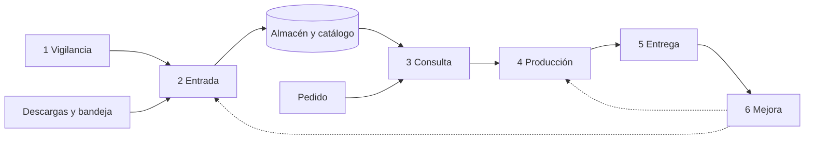

# 3. Diseño de la fábrica

Este documento describe la fábrica propuesta. Nada de esto está construido todavía.

## 3.1 El principio

La inteligencia se alquila y el contexto se posee. Los asistentes de IA pueden cambiar cada año. Los archivos, las reglas y el registro de trabajo deben quedar en lugares propios.

## 3.2 Las seis estaciones

| N.º | Estación | Insumo | Método | Resultado | Control |
| --- | --- | --- | --- | --- | --- |
| 1 | Vigilancia | Una lista de temas y de fuentes | Un agente en la nube busca con una frecuencia fija. | Un reporte fechado en la bandeja | El responsable ajusta los temas. |
| 2 | Entrada | La bandeja, las descargas y los libros nuevos | El sistema ficha, clasifica, renombra y mueve con registro para deshacer. | Una bandeja vacía y un catálogo al día | El responsable aprueba el plan de movimientos. |
| 3 | Consulta | Una pregunta y el catálogo | El sistema busca, lee y responde con cita artículo por artículo. | Una respuesta con fuentes | Un segundo agente comprueba cada cita. |
| 4 | Producción | Un pedido y una respuesta con fuentes | El sistema aplica la plantilla del tipo de producto. | Un borrador «por revisar» | Un guion revisa el estilo y la densidad. |
| 5 | Entrega | Un borrador aprobado | El sistema genera el Word final o publica la página. | Un producto entregado y registrado | El responsable firma o envía. |
| 6 | Mejora | El registro de pedidos | El responsable revisa cada semana lo devuelto y su causa. | Una regla nueva o una plantilla corregida | El responsable decide qué cambia. |

La estación Vigilancia se agregó al conocer el uso real del agente en la nube.

El análisis de datos queda fuera de las estaciones y funciona como taller. Cada pregunta de datos es distinta, y el objetivo ahí es aprender.

## 3.3 Dónde vive cada cosa

| Tipo de información | Casa única |
| --- | --- |
| Archivos y documentos | Google Drive |
| Libros | La biblioteca con signatura Dewey |
| Código y productos publicados | GitHub |
| Pedidos y su estado | Un tablero en Notion gratuito |
| Reglas y lecciones | La guía de trabajo, las skills y este repositorio |
| Conversaciones | El respaldo automático |

El tablero de Notion funciona como una hoja de Excel. Cada fila es un pedido y una columna dice su estado. El tablero guarda enlaces y no guarda archivos.

## 3.4 Quién hace el trabajo

| Trabajador | Papel | Límite |
| --- | --- | --- |
| Agente en la nube (hoy, Grok Bot) | Vigila temas y hace encargos con la PC apagada. Entra a sitios web que exigen sesión. | Sus resultados se quedan en su propia máquina si nadie los saca. |
| Claude en la PC | Archiva, busca con cita, escribe código y produce documentos. | Necesita la PC encendida para leer las carpetas locales. |
| Responsable | Decide, aprueba y firma. | Su tiempo es el recurso más escaso. |

Una regla une a los dos agentes. Todo reporte del agente en la nube debe caer en una carpeta fija de Drive. Sin esa regla, la fábrica no ve el trabajo de vigilancia.

El [Anexo D](anexos/d_claude_sin_supervision.md) explica por qué Claude no reemplaza hoy al agente en la nube.

## 3.5 Cómo se gobierna

Estas reglas vienen del libro *Scaling People*.

**Ficha por estación.** Cada estación tiene una página con su misión, su destinatario, sus métricas y sus riesgos. La ficha también dice qué recibe y qué entrega.

**Delegación.** El nivel de autonomía depende de dos preguntas: cuánto impacto tiene el trabajo y si el resultado se puede corregir.

| | El resultado se puede corregir | El resultado no tiene vuelta atrás |
| --- | --- | --- |
| **Bajo impacto** | El agente actúa sin preguntar. Ejemplos: fichas, catálogos y borradores. | El agente presenta un plan y espera el visto bueno. Ejemplo: mover o renombrar archivos. |
| **Alto impacto** | El agente actúa y el responsable revisa antes de la salida. Ejemplo: una página pública. | El responsable decide y firma. El agente solo prepara y verifica. Ejemplos: un documento oficial, una cita legal o un borrado. |

**Cadencia.** El responsable revisa la fábrica quince minutos cada semana, con un resumen que prepara el agente. El gasto se revisa una vez al mes. Los procesos se revisan cada seis meses, y se retiran los que ya no sirven.

**Métricas.** La fábrica mide pocas cosas: los pedidos cerrados por semana, los pedidos devueltos, las citas fallidas y la antigüedad de la bandeja.

**Señales de alarma.** El sistema falla si el estado de un pedido no se encuentra rápido. También falla si actualizar el tablero resulta molesto. En ese caso el tablero se simplifica.

## 3.6 La primera línea de producción: la carpeta de reunión

La carpeta de reunión es el producto que más se repite. Ya tiene un modelo y un borrador de reglas.

Las reglas actuales piden lenguaje diplomático y oraciones completas y cortas. El lector tipo es una autoridad que debe entender rápido un tema técnico. El texto no usa recursos de venta. La base de cada carpeta es un método de negociación.

| N.º | Proceso | Insumo | Método | Resultado | Quién |
| --- | --- | --- | --- | --- | --- |
| 1 | Registrar el pedido | La contraparte, la fecha y el objetivo | El responsable crea una fila en el tablero. | Un pedido registrado | Responsable |
| 2 | Reunir insumos | La carta de solicitud, las carpetas previas, la normativa y la web | Los agentes buscan y fichan cada fuente. | Un expediente de fuentes | Ambos agentes |
| 3 | Redactar el contexto | El expediente | Claude redacta los perfiles, la relación previa y los antecedentes. | Las secciones de contexto | Claude |
| 4 | Definir la posición | El contexto | Claude aplica el método de negociación: mensajes, puntos de atención y resultado esperado. | La posición sugerida | Claude y responsable |
| 5 | Resumir | Todas las secciones | Claude condensa la carpeta en una o dos páginas. | El resumen ejecutivo | Claude |
| 6 | Controlar | El borrador | Un guion verifica las cifras, las citas y las oraciones largas. | Un borrador «por revisar» | Claude |
| 7 | Entregar | El borrador aprobado | Claude genera el Word con el formato acordado. | La carpeta final | Responsable |

La skill de esta línea se construye en conjunto. El responsable escribe la descripción y las reglas. Claude propone, escribe los guiones y ejecuta.

## 3.7 Orden de construcción

1. **Archivo y búsqueda.** Este capítulo va primero. El plan está en el [documento 4](04_archivo_y_busqueda.md).
2. **Tablero único.** Los cuatro tableros de Notion se unen en uno.
3. **Carpeta de reunión.** La primera prueba es una corrida en sombra con una reunión real.
4. **Consulta con verificación de citas.**
5. **Tareas programadas.**
